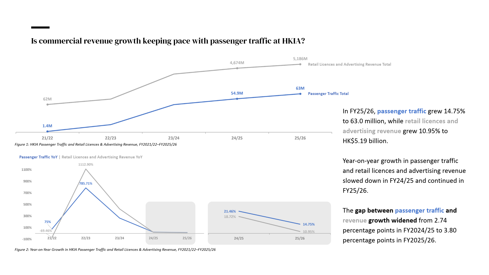
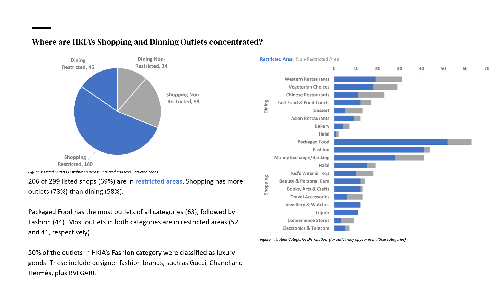
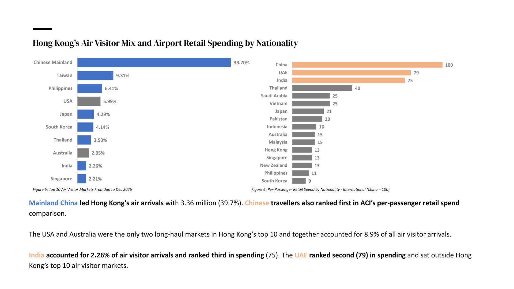
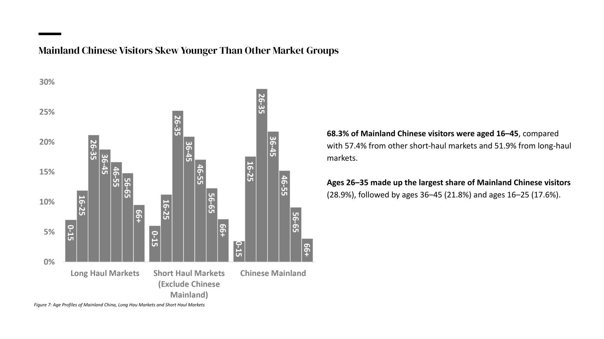
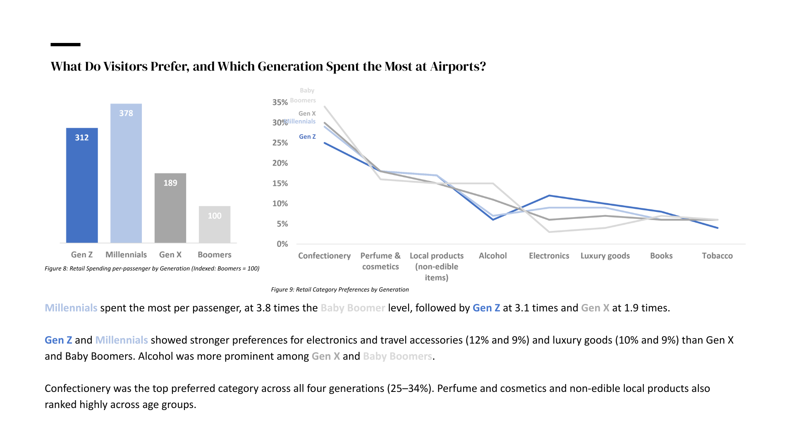
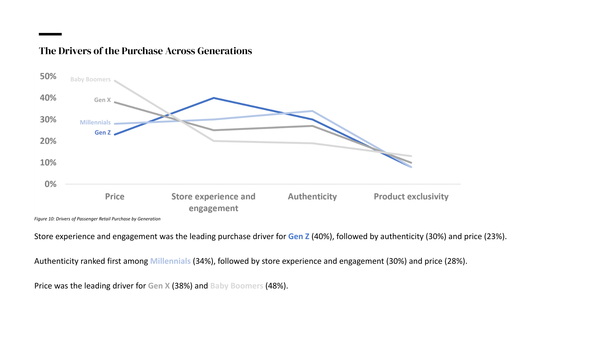

# Background Overview
Hong Kong International Airport (HKIA) has long been recognized as one of the world's leading and busiest airports. HKIA rebounded strongly after the pandemic. Passenger traffic and flight operations have mostly recovered. This raises a key question: has the recovery led to a proportional increase in revenue?

This project compares passenger traffic with retail licences and advertising revenue, and examines HKIA’s outlet mix alongside visitor profiles and airport shopping preferences.

The key stakeholders for this project are senior management, the retail leasing team, and the business planning and analytics team. The aim of this project is to identify growth opportunities and support future business planning.

**Source:** 

Hong Kong International Airport (HKIA) annual report FY2021/22, FY2022/23, FY2023/24, FY2024/25, FY2025/26

https://www.hongkongairport.com/en/airport-authority/publications/annual-interim-reports/

Hong Kong International Airport Shopping & Dinning Directory

https://www.hongkongairport.com/iwov-resources/custom/json/shops_en.json

Hong Kong Tourism Board (HKTB) **Visitor Arrival Statistics (monthly) 09/2026**

https://partnernet.hktb.com/en/research_statistics/research_publications/index.html?id=3631

Airports Council International (ACI) Travel Retail in the Post-Pandemic Era Study

https://www.aci-asiapac.aero/f/library/9778/Travel%20Retail%20Study%20Publication.pdf

# Data Manipulation
Used Python to extract outlet information from the HKIA Shops JSON file, including section (shopping, dinning, entertainment), shop category, outlet count, and restricted-area status.

Data is aggregated by category, location, and area to support retail mix analysis and visualization.

[Jupyter Notebook Run](https://github.com/mugendata/2_hkia_retail/blob/main/HKIA_Shop_Category_Analysis_Simple.ipynb)

# Executive Summary
In FY25/26, HKIA passenger traffic rose 14.75% to 63 million, while retail licence and advertising revenue grew 10.95% to HK$5.19 billion, trailing passenger traffic growth by 3.8 percentage points. 

Mainland China accounted for 39.7% of Hong Kong’s air visitor arrivals from January to September 2026 and ranked first in ACI’s regional comparison of airport retail spend per passenger. To build a higher-yielding shop mix, we recommend prioritizing Mainland Chinese visitors as the core target group, while reviewing India and the UAE as candidates for targeted promotions. We also propose pilot campaigns with airline partners to test whether they generate additional visitor arrivals and retail sales. Pop-up stores and limited-edition gift sets can be used to test demand and profitability before products are added to the permanent range in shops.
# Insights Deep Dive
1. HKIA's passenger traffic and retail licences and advertising revenue rebounded sharply in FY2022/23 and FY2023/24 from the pandemic.

**Takeaway**: Passenger traffic grew faster than retail licences and advertising revenue for two consecutive fiscal years. This raises a follow-up question: how closely does HKIA shop mix align with visitor preferences?

2. HKIA’s Shopping & Dining Directory provides an overlook of the airport’s shop mix.

**Takeaway**: Nearly three-quarters of HKIA’s listed shopping outlets are in restricted areas, where Packaged Food is the largest category by outlet count. How well does this shop mix meet visitors’ needs? Before answering the question, let's look into the composition of the visitors.

3. The charts are shown side by side to compare Hong Kong’s top 10 air visitor markets from January to September 2026 with airport retail spend per passenger by nationality. The arrivals data come from HKTB, and the spending index comes from ACI’s Travel Retail study.

**Takeaway**: Mainland China’s leading position in both rankings makes it the clearest market for a closer look at visitor profiles and shopping preferences. India and the UAE also deserve more attention, since both markets ranked top in the spending comparison, meaning both are worth exploring as potential markets for HKIA retail.

4. Mainland China was Hong Kong’s largest air visitor market. To understand this market in more detail, the chart compares the age profiles of Mainland China, short-haul and long-haul visitors (arrivals by all modes of transport not air only).

**Takeaway**: More than two-thirds of Mainland Chinese visitors were aged 16–45, a range that overlaps substantially with Gen Z and Millennial cohorts. This makes their shopping preferences worth exploring on younger travellers’ spending behavior.

5. ACI’s study compares airport retail category preferences across four generations and shows how retail spending per passenger varies by generation, using Baby Boomers as the benchmark.

**Takeaway**: Confectionery, perfume and cosmetics, and local products are preferred across all generations, these items are suitable as gifts. Gen Z and Millennials show a stronger preference for electronics and luxury goods, which aligns with their higher per-passenger retail spend relative to Gen X and Boomers.

6. Airport retail preferences vary by generation. ACI’s study also shows how generations differ in the drivers of purchase.

**Takeaway**: Price remains the leading purchase driver for older generations (Gen X and Baby Boomers), while younger generations (Gen Z and Millennials) prioritize store experience and authenticity over price. The traditional good-deal business model is shifting to experience and authenticity.

# Recommendations
**Senior Management | Review target groups and approve** pilot campaigns
- Target Mainland China visitors as the prioritized group for reviewing their preferences and needs, while India and the UAE are candidates for targeted promotions.
- Approve pilot campaigns with airline partners to attract more visitors to Hong Kong. Agree on success measures, including visitor arrivals increase and purchase conversion.

**Retail Leasing Team | Improve with retail partners**
- Review the assortment and accessibility of the retail outlets by terminal and gate area. Check whether passengers can easily find confectionery, perfume and cosmetics, and local gifts, which appeal across all generations.
- Use pop-ups or rotating displays to test Hong Kong gift collections, airport-exclusive beauty sets, and product demonstrations before committing to permanent products in the shops. Support retailers with guidelines for clear price tags and self-service displays, with staff advice available when needed.

**Business Planning & Analytics Team | Validate demand and measure impact**
- Compare results of the attracting more visitors to Hong Kong campaigns against comparable group of flights. Track purchase conversion, average transaction value, and retail revenue to see whether the campaigns generated additional purchases.
- Analyze the location of electronics and luxury goods outlets, and test whether outlets near destination gates, which may favorable by younger travelers, perform better.
